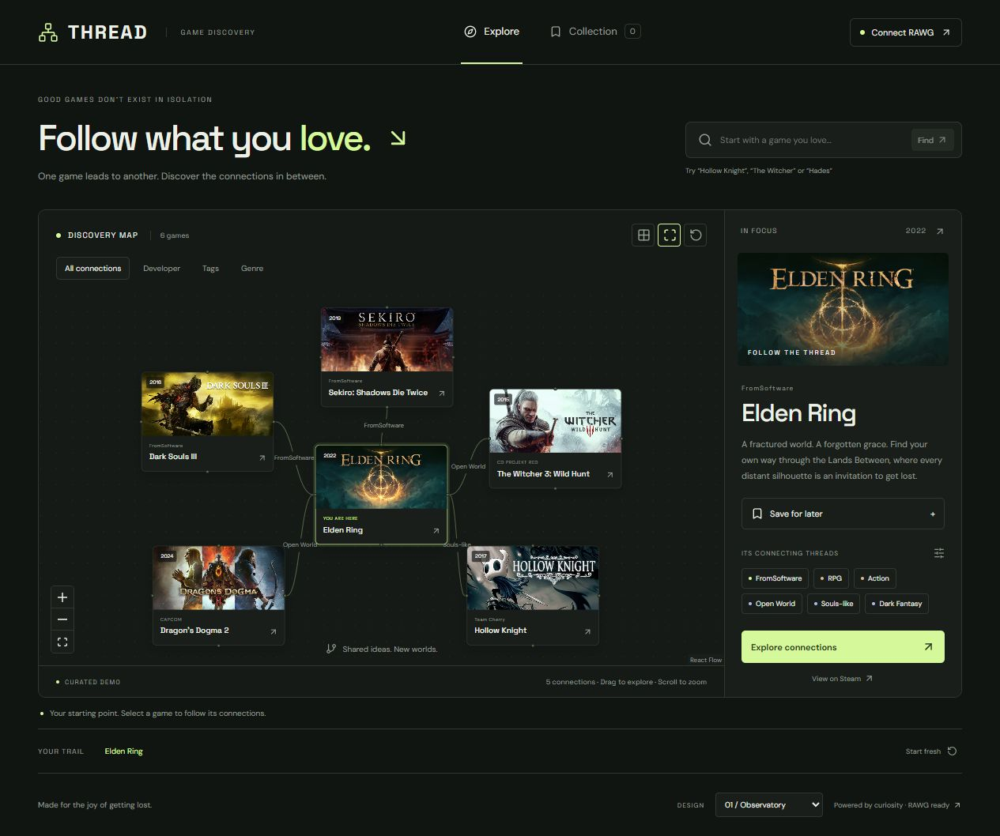
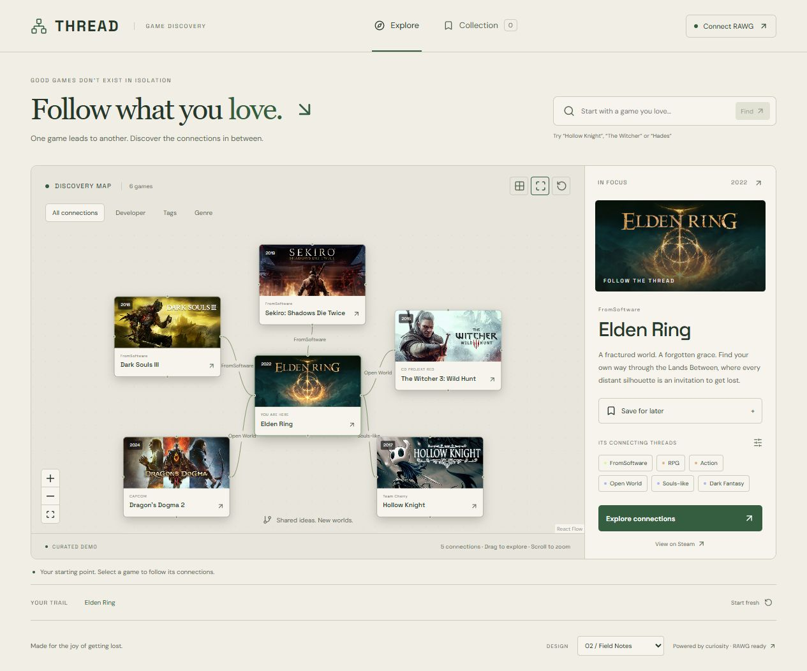
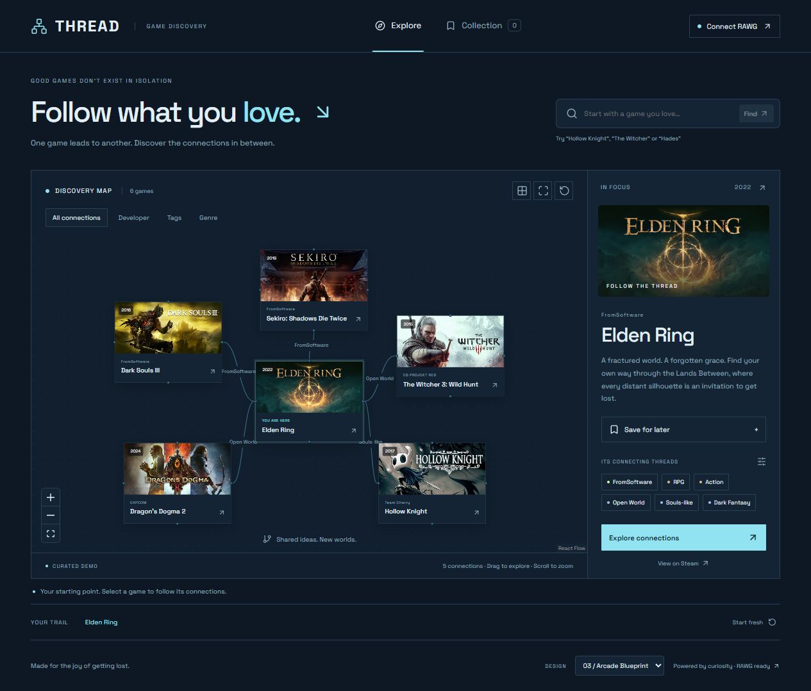
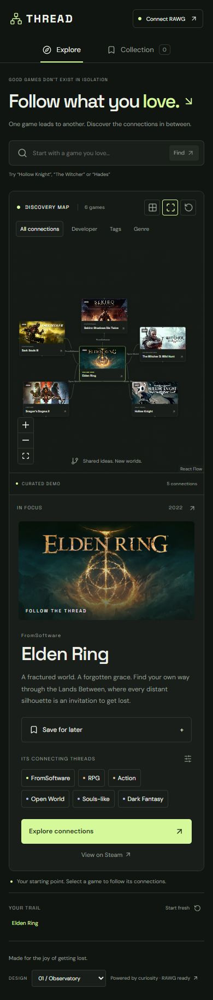

# Three design variations

All three are available from the appearance selector in the running demo. They share functional behavior so comparison is meaningful.

## 01 — Observatory (selected default)
Charcoal-green canvas, electric chartreuse focus, muted sage connections, image-first nodes, compact mono labels. A large editorial heading anchors the quiet interface. The graph reads as a constellation of playable worlds. Best fit for a memorable entertainment demo.

## 02 — Field Notes
Warm paper canvas, forest-green accents, serif headline and crisp ink borders. A catalog research feel with less visual intensity. Same artwork and spatial map; stronger reading comfort in bright environments.

## 03 — Arcade Blueprint
Deep navy, icy cyan focus, technical mono typography, squared controls and denser grid. A precise systems-map character, suited to players who enjoy inspecting connections.

Composition: persistent top navigation; discovery title and search above a large canvas; graph toolbar at the top-left; selected game inspector at the right; exploration trail below. Mobile stacks the inspector beneath a contained graph. The optional list view supports linear exploration and keyboard access.

Assets: recognizable game header art from Steam's public CDN, with text/gradient fallback. No fabricated screenshots or decorative AI artwork. No autoplay media. Camera animation is brief and disabled by reduced-motion preference. Node movement belongs to user input.

## Captured implementations

